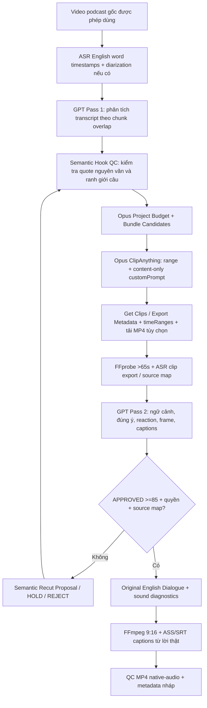

# LOCAL PODCAST FORGE v1.1 — OPUSCLIP EXPERT CUT

**Ngày:** 2026-10-17 · **Nguồn:** Podcast tiếng Anh US/UK, có quyền sử dụng · **Giọng:** Giữ audio gốc, KHÔNG ElevenLabs · **Output:** 9:16 MP4, sub Anh từ word timing, mô tả/hashtag nháp.

**SPEC này ghi đè v1.0.** Gói này là thư viện/script và các adapter tùy chọn, chưa phải ứng dụng một nút. Tính năng nhận diện khuôn mặt/active-speaker tự động local và API polling production chưa tích hợp.

## 1. KIẾN TRÚC CHUẨN



**Ba nguyên tắc:** Không bịa quote để tăng view; không tự cắt mất câu phản biện gây sai ý; không coi điểm viral của bất cứ model nào là dự đoán lượt xem.

## 2. THAY ĐỔI so với v1.0

### P0 — `SEMANTIC_HOOK_QC`

- `podcast_director.validate_precut()` yêu cầu **trọn cụm quote nguyên văn**, match chuỗi token liên tiếp từ transcript có timestamp ở đầu đoạn. Từ đơn như “I”, “the” và câu chung chung thiếu từ khóa nội dung không được dùng làm bằng chứng.
- GPT chọn cửa sổ 70–100s, chứa nội dung có tiền đề → triển khai → kết luận. Câu `payoff_quote` vẫn cần người/GPT kiểm tra thật ở đoạn cuối, đặc biệt với nội dung mang tính tranh luận.
- `transcript_boundaries()` kiểm tra khoảng lặng đầu/cuối, nhưng **không tự kết luận câu bị cắt dựa duy nhất vào dấu câu ASR**. Vòng GPT + người nghe quyết định tính toàn vẹn ngữ nghĩa.
- Vòng review hiện có: `complete_thought`, `meaning_not_distorted`, `begins_at_natural_boundary`, `ends_at_natural_boundary`, `clear_english_dialogue`, `speaker_framing_ok`, source rights, mapping. Điểm ≥85 chỉ có ý nghĩa nếu toàn bộ hard gate qua.

### P0 — `OPUS_BATCH_OPTIMIZER`

- `opus_expert_core.bundle_candidates()` gom các khoảng GPT gần nhau hoặc giao nhau (mặc định cách ≤18s, tổng nhóm ≤220s, tối đa 3 candidate/nhóm), **không gom những cuộc trò chuyện xa nhau** chỉ để tiết kiệm request.
- Chỉ gửi 1 ClipAnything project/nhóm. Đáp ứng `range`, thời lượng `clipDurations` 70–100s; **không cam kết** Opus sẽ tạo clip riêng cho từng candidate.
- Prompt đúng chuẩn **chỉ mô tả chủ đề, ý kiến, lời nói, cảm xúc cần tìm**, không ra lệnh sửa video/âm thanh/sub. Layout 9:16, tắt Opus captions khi local burn SRT/ASS, tắt emoji/B-roll và remove-filler ở `renderPref`.
- `podcast_opus_submit.py --execute` có **chốt ngân sách mặc định tối đa 8 projects/lượt**. Có thể thay qua `--max-projects` sau khi kiểm tra số credits của tài khoản. Không có công thức đảm bảo số credits tiết kiệm.

### P0 — `OPUS_EXPORT_MANAGER`

- `opus_export_manager.py get-clips --project-id ...` gọi `GET /api/exportable-clips?q=findByProjectId&projectId=...` khi thêm `--execute`; mặc định dry-run không tốn/API.
- `opus_transcript_manager.py` gọi endpoint nguồn `GET /api/transcripts?...`; giữ word timestamps và nhãn speaker (nếu có). **Transcript nguồn nằm ở thời gian nguồn, không được gắn trực tiếp cho MP4 đã cắt ghép hay reorder**.
- Chuẩn hóa `uriForExport`, `timeRanges` (ví dụ của Opus dùng mili-giây) sang `source_ranges_sec`, giữ projectId. Nếu thiếu mapping, trùng group, hoặc export nằm ngoài cửa sổ GPT → HOLD; không tự gán candidate.
- `download --execute` tải file MP4 từ URL `https` domain Opus tin cậy, giới hạn kích thước và chặn redirect; các CDN chuyển hướng chưa được xử lý tự động.
- Chưa có scheduler/webhook polling thông minh: có thể chạy Get Clips khi Opus báo xong, hoặc kết nối webhook đã được xác minh chữ ký ở production.

### P0 — `SEMANTIC_AUTO_RECUT` (có chốt an toàn)

- `podcast_semantic_recut_v11.py plan` dùng transcript **nguồn**, source mapping, và lời chỉ dẫn GPT (`post_review.recut_instruction`) tìm ranh giới câu trong phạm vi 10s quanh start/end.
- `opus_recut_engine.py` thực thi FFmpeg **từ video nguồn** sau khi có `--approved-boundary` (không kéo dài trực tiếp clip Opus có thể đã đảo cảnh).
- Nếu một clip gồm nhiều mảnh nguồn/reorder, thiếu transcript hoặc không tìm được câu kết → HOLD để biên tập viên xử lý EDL, tuyệt đối không tự bịa một đoạn ghép.
- Tối đa 2 lần recut/clip. **Clip recut chưa được APPROVED**: phải chạy lại ASR, clip evidence, GPT Pass 2, rights/mapping và hash. Không tái sử dụng sub cũ.

### P1 — Audio + Visual

- `opus_audio_qc.py`: FFprobe/FFmpeg kiểm tra có audio, RMS, peak và silence >0.7s dưới -40dB. Cờ số liệu chỉ **gợi ý**, không chứng minh lời nghe rõ hay cảm xúc tốt; người duyệt phải nghe.
- Opus `renderPref.enableSplitLayout=true` đề xuất bố cục hai người và tắt Opus caption nếu local burn. Không tuyên bố đã có active-speaker tracking/reaction crop local tự động.
- Giữ AAC bitstream `-c:a copy` khi cấu hình preserve (đã có từ v1.0); chỉ chạy `dialogue_mild` khi có nhu cầu EQ/loudnorm. Đừng xóa tất cả filler và khoảng ngập ngừng vì có thể đổi ý nghĩa câu.
- Phụ đề tiếng Anh 1–4 từ/cụm từ timestamp thực, Inter nếu máy có font, vị trí khoảng 85% video, tạo `.srt`/`.ass`. Caption QA thực tế cần kiểm tra speaker changes và crop safe zone.

## 3. QUY TRÌNH CLI

Trong thư mục `Podcast_Forge_v1.1_OPUS_EXPERT`:

```bash
pip install -r requirements.txt
PYTHONPATH=.:tests pytest -q tests/test_podcast_v1.py tests/test_podcast_v11_expert.py tests/test_opus_expert_shared.py

# 1. Input MP4 và English word-timed ASR nguồn từ faster-whisper/Opus provider đã có.
python podcast_gpt.py precut --media /work/source.mp4 --transcript /work/source_tx.json --model YOUR_API_MODEL --out /work/precut_plan.json
# 2. Rights phải VERIFIED trong precut plan; tạo Opus jobs (nội dung prompt vs render controls tách riêng):
python podcast_director.py opus-jobs --media /work/source.mp4 --transcript /work/source_tx.json --precut /work/precut_plan.json --url 'https://...' --output /work/opus_jobs.json
# 3. Dry-run rồi mới gửi Opus có thể tính credit:
python podcast_opus_submit.py --jobs /work/opus_jobs.json --output /work/submissions.json
python podcast_opus_submit.py --jobs /work/opus_jobs.json --output /work/submissions.json --execute --max-projects 8
# 4. Lưu project ledger và đọc export:
python opus_export_manager.py ledger --jobs /work/opus_jobs.json --submissions /work/submissions.json --output /work/ledger.json
python opus_export_manager.py get-clips --project-id PROJECT_ID --output /work/opus_clips.json --execute
# 5. Dùng normalize/match metadata để xác nhận nguồn của export, rồi tải MP4 và tạo clip-aligned ASR.
python opus_transcript_manager.py --project-id PROJECT_ID --out /work/source_transcript.json --execute
# 6. Chỉ sau khi clip >65s, GPT review, quyền và mapping verified:
python podcast_director.py review --clip-folder /work/clip_001 --source-media /work/source.mp4 --source-transcript /work/source_tx.json --precut /work/precut_plan.json
python podcast_render.py --folder /work/clip_001 --audio preserve
python opus_audio_qc.py --media /work/clip_001/final.mp4 --output /work/clip_001/audio_diagnostics.json
```

`GET Clips` có thể trả nhiều clip trong một project; phải có bước gán đúng candidate theo timeRanges khi đã bundle. Dữ liệu `source_mapping.json` cũ thuộc bản v1.0 vẫn được validator xác thực; không coi một group match là candidate-approved tự động.

## 4. GIỚI HẠN / AN TOÀN

- API OpenAI/Opus không được test live trong lượt cập nhật này. Token, credits, plan, brand templates và chính sách API thực tế cần kiểm tra bằng tài khoản của bạn. Tên model phải là model ID API thực sự có quyền sử dụng.
- Opus `range` chỉ giới hạn vùng tuyển chọn, **không ép chính xác start/end**. Có thể dùng FFmpeg recut nguồn đã được phép dùng, sau đó phải duyệt lại cả nội dung và khung hình.
- Không tự phân biệt speaker bằng khuôn mặt/hệ thống face-ID. Split layout chỉ yêu cầu trình renderer Opus sử dụng layout phù hợp.
- `Get Clips` `timeRanges` nguồn có thể nhiều khoảng; nếu reorder thì cần mapping lại timestamp. **Tuyệt đối không sử dụng timestamp của video nguồn làm timestamp của clip export.**
- Ngưỡng >65s là yêu cầu riêng cho quy trình này, **không đảm bảo** đủ điều kiện TikTok Creator Rewards. Không có chỉnh metadata/crop/sub nào đảm bảo tránh phát hiện reupload hoặc bản quyền.
- Cần có license/permission phù hợp cho podcast người khác; việc cắt có bình luận/sub không tự động đủ Fair Use/monetization.

## 5. THAM KHẢO NGUỒN CHÍNH THỨC (đã đối chiếu)

- OpusClip Create Project: https://help.opus.pro/api-reference/endpoints/create-project
- ClipAnything Prompt Manual: https://help.opus.pro/docs/article/clip-anything-prompt-manual
- Render Pref schema: https://help.opus.pro/api-reference/schemas/render-preferences
- Get Clips API: https://help.opus.pro/api-reference/endpoints/get-clips
- Source Transcript API: https://help.opus.pro/api-reference/endpoints/transcripts/get-transcript

**Phạm vi triển khai:** các code và tests thực thi offline được cung cấp; live transcript/output sync, active speaker local & webhook orchestration là việc còn lại cho coding agent.
