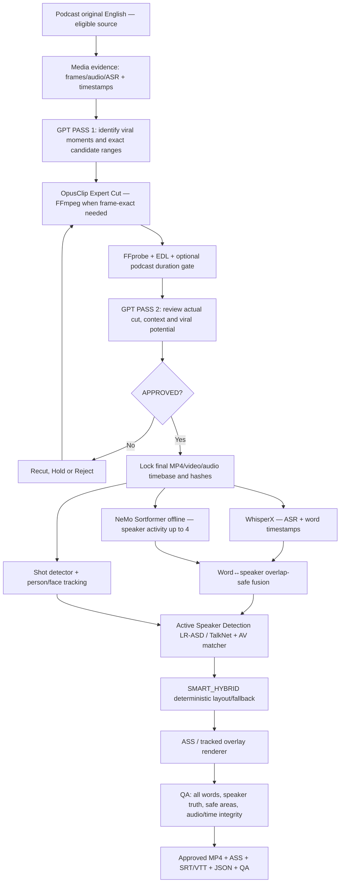

# PODCAST FORGE v1.2 — NVIDIA NeMo Sortformer Multi-Speaker Captions

**Version:** 1.2 | **Date:** 2026-10-17 | **Status:** Implementation-ready SPEC, *not a completed neural inference/tracking integration*.  
**Upgrades:** Podcast Forge Multi-Speaker Captions v1.1; adapted from the supplied *Local Video Forge — Multi-Speaker AI Captions v1.1 NeMo Sortformer Edition*.  
**Product:** Podcasts in native English (US/UK), source YouTube/MP4 when use rights are secured. **No ElevenLabs, no rewriting speakers' dialogue, no source speech removal.**

## 0. Contract / what does not change

- **Cutting pipeline stays GPT-first:** source video and real timestamp evidence → GPT pass 1 viral moments → OpusClip Expert Cut (or precise FFmpeg) → GPT pass 2 reviews actual exports → approved final video → timeline lock → captions → QC/export.
- **Native audio is the authority** for words, identities and timings. GPT may assist with semantic review and clip selection, not manufacture missing dialogue or fake speaker identities.
- **Sortformer replaces pyannote as the PRIMARY diarization model**; pyannote is not run on happy path. Optional explicitly approved licensed fallback when necessary.
- WhisperX is **independent** ASR + forced alignment; Sortformer does not provide the written transcript or person names.
- **Caption modes:** `SPEAKER_COLOR`, `CHARACTER_TRACK`, `SMART_HYBRID` (default; per-caption decision). Tracking must fail over to fixed color when visual identity uncertain.
- **Duration:** `>65s` is OPTIONAL for podcast campaign (default false). The hard `>65s before ElevenLabs` gate belongs to the **separate ASMR pipeline** and MUST NOT be imported here.
- **No ElevenLabs and no full-script coverage check for newly generated narration**, because the podcast maintains the real interview voices. Instead check caption-word coverage against final native speech.
- Media rights remain a separate hard gate. Reformatting, captions and cropping do not create license to reuse somebody else's show.

## 1. Full runtime dataflow



**Stage order is mandatory:** transcribe/diarize **only the locked final clip audio**, not the original long podcast audio with incompatible timecodes. Recuts, speed changes, audio treatment, shot crop changes and a changed EDL invalidate all downstream artifacts and cached decisions.

## 2. Model allocation by function

| Function | Default | Real output | Scope limit |
|---|---|---|---|
| Pre/post-cut content reasoning | GPT with supplied multimodal timestamped evidence | `precut_plan.json`, `postcut_review.json` | Can't infer events from an unviewed URL |
| Actual cut | OpusClip + optional FFmpeg | approved MP4, verified source EDL | OpusClip requested range is not a frame-perfect guarantee |
| English ASR and timing | **WhisperX** | full transcript + word start/end | Low-confidence words go to human QC |
| Who spoke when | **NeMo Sortformer offline** `nvidia/diar_sortformer_4spk-v1` | overlapping speaker activity, speaker segments | Up to **four distinct speakers**, checkpoint license gate |
| More than 4 / blocked license | approved alternative provider | normalized diarization | Provider selection explicit; not auto pyannote |
| Shot changes and visual IDs | PySceneDetect + OpenCV + tracker | visual `P*@shot*` tracks | Tracking does not imply speaking |
| Is the visible face speaking? | LR-ASD, optional TalkNet | active-face evidence | Must time-sync audio/video; calibrate on real podcast |
| Visual segmentation (optional) | SAM 2 | stabilized tracks/masks | Not a voice↔face identifier |
| Layout | deterministic `SmartHybridPlanner` | caption event geometry | GPT suggestion cannot override guardrails |
| Output | FFmpeg/libass, optional dynamic video overlay | MP4, ASS, SRT/VTT | Preserve exact approved audio master |

**Commercial-weight compliance:** model card of the offline Sortformer checkpoint declares **CC BY-NC 4.0** (reference https://huggingface.co/nvidia/diar_sortformer_4spk-v1). The NeMo *code* license does not override the *weights* license. If `commercial_mode=true`, do not download/run the model without documented appropriate rights; return `BLOCKED_LICENSE`. Select a separately approved commercial-compatible diarizer if needed. Never imply that enabling a flag magically grants permission. Streaming v2.1 is different and is not a silent substitute; independently confirm its licensing and implementation.

## 3. Critical preflight gates

1. `RIGHTS_VERIFIED`: editor/license gate for the specific source, footage and soundtrack.
2. `APPROVED_CLIP`: GPT postcut QC accepted, audio/video file hashes and EDL fit the review.
3. `TIMELINE_LOCKED`: signed revision or SHA-256-derived revision of real clip + final native audio + EDL/crop.
4. `DURATION_POLICY`: if `monetization_gt_65s=true`, FFprobe actual media duration must be **strictly >65.000**; otherwise not a gating criterion for podcast.
5. `MODEL_LICENSE_OK`: exact checkpoint+revision and allowed use must be resolved **before model download/inference**. In `commercial_mode`, unapproved CC BY-NC offline checkpoint must be blocked.
6. `SPEAKER_CAPABILITY_OK`: confirmed <=4 unique voices for selected Sortformer processing; if >4 or uncertain, HOLD or approved licensed fallback. Chunking cannot extend this capability.
7. `ASR_COVERAGE_OK`, `DIARIZATION_OK`, `AV_MATCH_SAFE`, `RENDER_QC_OK` before delivery.

## 4. Canonical technical inputs and schema

Audio-derived analysis path: locked final 48kHz stereo audio retained as master → derived WAV mono/16k PCM for Sortformer, derived ASR audio as supported by WhisperX. Track resampling offset precisely; no acoustic editing of master. Record `source_audio_sha256`, `normalized_audio_sha256`, `timeline_revision`, model checkpoint commit, code versions, processing offset, sampling rate and output checksum.

**Diarizer normalized output**, not a claim about the literal NeMo SDK response:

```json
{
  "engine": "nemo_sortformer",
  "model_id": "nvidia/diar_sortformer_4spk-v1",
  "revision": "PIN_CHECKPOINT_COMMIT_BEFORE_DEPLOYMENT",
  "timebase": "final_locked_audio",
  "max_supported_speakers": 4,
  "activity": [
    {"start": 2.00, "end": 2.08, "active_speakers": ["S1"]},
    {"start": 2.08, "end": 2.16, "active_speakers": ["S1", "S2"]}
  ],
  "segments": [
    {"start": 1.94, "end": 3.20, "speaker_id": "S1"},
    {"start": 2.08, "end": 2.67, "speaker_id": "S2"}
  ],
  "confidence": null,
  "warnings": []
}
```

Do **not** assign fabricated confidence values; if SDK provides no calibrated probability, use `null`. `speaker_id` stable *within the locked clip* **after reconciliation**, not across unconnected podcast sources. Track names/roles `HOST/GUEST` only when confirmed by editor/source evidence; use `Speaker 1/2` by default.

**Caption event schema (final timeline only):**

```json
{
  "event_id": "c001",
  "start": 12.05,
  "end": 13.44,
  "text": "That's not what I said.",
  "speaker_id": "S2",
  "assignment_status": "REVIEW_REQUIRED",
  "speaker_confidence": null,
  "overlap_speaker_ids": ["S1"],
  "visual_track_id": null,
  "active_speaker_evidence": null,
  "mode": "SPEAKER_COLOR",
  "fallback_reason": "unverified_face_or_overlap",
  "words": [{"text":"That's","start":12.05,"end":12.31}]
}
```

Maintain a canonical word/token ID for comparing original accepted ASR with rendered captions. Individual captions may split words into short phrases but never silently delete or fabricate words.

## 5. Sortformer diarization and long-form handling

- Pinned offline checkpoint `nvidia/diar_sortformer_4spk-v1`; import via compatible pinned NeMo API, e.g. `SortformerEncLabelModel.from_pretrained(...)`. Initialization once per worker, **not each segment**.
- Prefer whole-final-clip inference when memory permits. If splitting, use voice-aware boundaries plus ~2–5s overlap (starting heuristic), map local speaker labels across chunks through overlap evidence and (if separately available/licensed) voice embeddings. A speaker numbered `0` in independent chunks is not necessarily the same person.
- Create auditable `speaker_registry.json`: local→global ID mapping, evidence and confidence/unknown state, human edit history. Genuine ambiguity → UNKNOWN/review. Avoid voice swaps at hard cuts, B-roll and camera changes.
- Sortformer up to four **distinct** speakers: when >4 voices, do not silently reuse an existing label. Set `UNSUPPORTED_SPEAKER_COUNT`, ask operator or use explicitly configured approved alternative. Distinguish audible number of people from detected count; unexpected extra voices/laughter/remote guests require review.
- Preserve overlapping speech as multi-label intervals. Do not flatten overlapping S1+S2 into a fake continuous single speaker.
- SDK result shapes may vary by release. Adapter must inspect and normalize real returned tensors/segments and test round-trip timing at the pinned NeMo release.

## 6. WhisperX fusion — words belong to actual voices

1. WhisperX transcribes **final locked native audio** and supplies word timing; ASR text and Sortformer speaker activity are independent signals.
2. Each word is intersected against speaker activity across its duration; choose a unique label only when evidence favors one voice and passes tuned error gates. Include brief continuity and turn context, not camera position.
3. If a word overlaps simultaneous speech, **do not assign the same recognized word to both voices by copying it**. Use `UNKNOWN`, request source-separation retranscription per speaker when available, or flag editorial review.
4. True overlapping words may be missing from a mono mixed ASR track. Set `overlap_transcript_status=INCOMPLETE`; cannot claim 100% transcript coverage without recovery/manual verification.
5. Keep short interjections (`yeah`, `no`, laughter) despite smoothing; do not erase meaningful 150–300ms speech turns.
6. At output compare approved word IDs to rendered events: all accepted spoken words represented exactly once, unless an explicit `edits[]` decision explains removal. If any unlogged omission, HOLD.

## 7. AV matching and safe Smart Hybrid captions

Face/person track IDs are not Sortformer voice IDs. After shot detection and portrait crop mapping, run synchronized LR-ASD or TalkNet to infer visible mouth-speech activity over multiple turns. A single talking face shown on screen **does not prove** it is the audible speaker (reaction shot / offscreen host / dubbing / B-roll).

A `CHARACTER_TRACK` event requires **all** of the following default candidate gates (must calibrate on real videos):

- AV identity association confidence >= **0.85** (from calibrated AV association, not Sortformer confidence).
- Person track quality >= **0.80** and visible for >= **75%** of event.
- Positive active-speaker evidence or explicit editor verified mapping.
- No unresolved shot boundary, competing face, offscreen voice, unclear lip visibility or > **250ms** tracking gap.
- Safe anchor near torso/free space (not eyes/mouth/critical gestures), no TikTok UI overlay, no subtitle collision and smooth motion.

If any fails → `SPEAKER_COLOR` fixed on safe region, with stable color and neutral label. No automatic wrong-face subtitles. `SMART_HYBRID` decides **per shot/event**; hysteresis delta <0.12 holds previous mode, minimum style dwell ~1.2s except cuts/speaker switches, transitions 100–180ms. For overlapping voices show distinct stacked cues when readable; otherwise review rather than merge or drop words.

Common podcast corner cases: split-screen host/guest, fast interruption, reaction shot, only silent listener in frame, voiceover over B-roll, remote guest, camera cut mid-word, portrait crop reframe, multiple visible faces, music/laughs, inconsistent microphones, already burned-in source captions. Every case needs deterministic fallback.

## 8. Editorial style and deliverables

- 1080x1920, 9:16; **Inter Bold equivalent**, fixed base ~56px (editable), at most 2 lines; short groups 1–5 words or ~26–34 chars/line if fit.
- Fixed anchor y≈0.78 (adjustable 0.74–0.82 after preview) and verified TikTok interface safe-area profile. This deliberately differs from ASMR Y=0.85.
- Speaker palette S1 `#63E6BE`, S2 `#74C0FC`, S3 `#FFD67A`, S4 `#D0BFFF`; labels must not rely on color alone.
- Tracking caption anchor should approach the active person's shoulder/torso but move minimally. Word highlighting is optional. Avoid jitter, flash, loud sound effects and excessive zoom that distract from podcast facial cues.
- Render ASS via libass for mostly fixed/piecewise anchors; use dynamic overlay only when true frame-level tracking is required and reliable. Export final MP4, editable ASS, plain SRT/VTT, canonical JSON, `caption_qa.json`, ambiguity and license audit logs. Plain SRT cannot preserve colored / moving captions by itself.
- Preserve locked final audio. Prefer stream copy if muxing supports it; when recompression is necessary, document codec/latency and compare PCM decode alignment; **bit-exact source audio is not guaranteed** after re-encode.

## 9. QC, observability and hard stops

### QA must log

- Audio/model/EDL SHA hashes and `timeline_revision`; selected checkpoint/revision, license decision and exact model provider.
- ASR transcript word count and approved text hash; caption rendered word IDs, missing/duplicated word IDs, timestamps/overlap warnings.
- Speaker ID changes, ambiguous overlaps, chunk-boundary remaps, estimated active speaker tracks, manual role changes.
- Each tracked event's evidence, confidence and safe-zone samples; any fixed fallback reason.
- Measured audio and video durations, A/V offset, final audio differences (and when actual stream copy is possible, byte/checksum comparison of audio streams).

### Fail closed decisions

| Case | Required state |
|---|---|
| Model weights incompatible with commercial workflow | `BLOCKED_LICENSE` — never infer |
| >4 distinct speakers on selected Sortformer, no approved fallback | `UNSUPPORTED_SPEAKER_COUNT` / HOLD |
| NeMo missing/incompatible/CUDA OOM | HOLD or explicit licensed fallback; no fake speaker labels |
| Human faces unverified for active voice | `SPEAKER_COLOR`, not `CHARACTER_TRACK` |
| Overlapped voice cannot be transcribed | `INCOMPLETE_TRANSCRIPT` / review |
| Missing word(s) in subtitles without documented edit | `CAPTION_COVERAGE_FAIL` |
| Caption overlay in UI/face region | `LAYOUT_UNSAFE` → fixed/replan |
| Timeline/audio revised after analysis | `TIMELINE_STALE` → rebuild |
| < or = 65s in podcast campaign with strict mode enabled | `DURATION_FAIL` |

### Internal test suite (not benchmark claims)

- Annotated 1/2/3/4 speaker clips; 5+ speaker hard stop and approved fallback.
- 65s/80s/5min/60min samples; independent overlapping chunks and stable ID reconciliation.
- Interruptions at 0.2/0.5/2s; simultaneous crosstalk; laughter; crossfades; remote guests; music/compressed clips.
- Silent visible listener vs off-camera speaker; split-screen; hard cut mid-sentence; B-roll; face occlusion; portrait crop change.
- Regression no missing approved words, no unverified face track, color stability, no altered original conversation, no unintended ElevenLabs requests.
- Run a real golden-set comparison against the prior pyannote baseline and measure DER **with overlapping speech**, wrong-speaker words, subtitle coverage, AV tracking errors and latency before declaring Sortformer 'better'.

## 10. Config and implementation interfaces

Preset lives in `podcast_sortformer_preset_v12.json`. The included `policy_gate.py` is **a runnable policy-only reference**, not NeMo inference or active-speaker tracking. It checks source rights, timeline/approval, optional duration, noncommercial checkpoint permission and >4-speaker failure. Production must enforce these gates in the worker that actually calls NeMo.

Recommended module boundaries:

```text
podcast_forge/
  selection/                       # GPT 1 -> OpusClip -> GPT 2 (unchanged)
  captions/
    media_probe.py                  # locked final timeline + hashes
    asr_whisperx.py                 # transcribe + align
    diarization_sortformer.py       # model worker, pinned revision
    license_gate.py                 # before checkpoint download/inference
    chunk_reconciler.py             # stable S1..S4 across chunks
    overlap_fusion.py               # word->speaker with uncertainty
    shot_and_person_tracker.py
    active_speaker_lr_asd.py        # or TalkNet
    speaker_face_matcher.py
    layout_smart_hybrid.py
    render_ass.py
    render_dynamic.py
    quality_gate.py
    speaker_editor.py
  output/                            # MP4/ASS/SRT/JSON/QC
```

**Lifecycle**:

```python
def produce_podcast_captions(approved_final_clip, preset):
    check_rights_approval_duration_timeline_and_license(approved_final_clip, preset)
    final_audio = lock_native_final_audio(approved_final_clip)
    words = whisperx_transcribe_and_align(final_audio)
    diar = nemo_sortformer_diarize_normalized(final_audio)  # not TTS
    diar = global_reconcile_if_chunked(diar)
    fused = overlap_aware_word_speaker_fusion(words, diar)
    shots, people = detect_shots_and_person_tracks(approved_final_clip)
    av_matches = active_speaker_detection(fused, people, final_audio)
    caption_plan = smart_hybrid_caption_layout(fused, av_matches)
    enforce_caption_coverage_and_layout_gates(caption_plan)
    final_video = render_caption_overlay_without_rewriting_audio(approved_final_clip, caption_plan)
    post_render_qc_and_export(final_video, caption_plan)
    return final_video
```

## 11. Implementation phases / definition of done

- **Phase 1 MVP:** license gate + real WhisperX + real offline Sortformer + stable caption colors/labels + original audio + static ASS + coverage checks. Only this phase is necessary to deliver basic useful speaker-colored podcast subtitles.
- **Phase 2:** face/shot tracker and editor-assisted voice↔person assignments; no unsupported auto attachment.
- **Phase 3:** LR-ASD/TalkNet video/audio verification, Smart Hybrid event-level auto mode, tracked caption renderer with safe zones and preview.
- **Phase 4:** cache invalidation, incremental export, operator UI, benchmarked reliability across diverse real podcasts.

**Definition of Done:** on permitted production media with licensed models, the pipeline can load a GPT-approved final podcast clip, produce a complete timestamped native-English transcript, label every confidently attributable word with a stable speaker, flag overlaps/unknowns honestly, optionally track only verified active faces, show editable captions, export approved MP4+ASS+SRT+JSON+QA, and preserve original spoken content. The module disabled must not change preexisting Podcast Forge exports.

## 12. References and provenance

- Base user's supplied `Local_Video_Forge_Multi_Speaker_AI_Captions_v1.1_NeMo_Sortformer_SPEC(1).md` (Sections 13–21 adapted to Podcast Forge).
- Prior `SPEC_Podcast_Forge_Multi_Speaker_Captions_v1.1.md` (podcast-only workflow and caption layout preserved).
- Model: https://huggingface.co/nvidia/diar_sortformer_4spk-v1 — weights CC BY-NC 4.0 at time of update.
- NVIDIA NeMo examples: https://github.com/NVIDIA-NeMo/Speech/blob/main/examples/speaker_tasks/diarization/README.md
- WhisperX: https://github.com/m-bain/whisperX
- Optional AV: https://github.com/TaoRuijie/TalkNet-ASD

**Status warning:** No live NeMo inference, WhisperX accuracy, AV speaker detection, OpusClip or full media rendering benchmark is claimed by this package. Only separately identified pure-code policy tests may be run.
