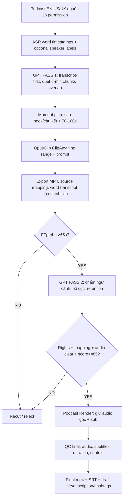

# LOCAL PODCAST FORGE v1.0 — ENGLISH NATIVE VIRAL DIRECTOR

**Mục tiêu:** Nhánh chuyên cắt clip từ podcast tiếng Anh Mỹ/Anh, giữ giọng host/guest nguyên bản, không dùng ElevenLabs, không dịch, không chèn giọng thuyết minh AI. Xuất MP4 dọc 9:16, SRT/ASS tiếng Anh theo lời nói có thật, cùng description/hashtags dạng draft tùy chọn.

**Nền tham khảo:** Local Video Forge v3.6 (mô hình hai vòng GPT → OpusClip → GPT Review, Duration Gate >65s). Mọi hợp đồng `full_story_writer`, `story_coverage`, `TTS`, `Clean ASMR` dành riêng ngách cơ khí **KHÔNG được dùng cho Podcast**.

## 1. Quy trình chuẩn



**Hai vòng GPT là bắt buộc:** GPT 1 dựa transcript **toàn nguồn** và sampled frames, OpusClip cắt từng cửa sổ, GPT 2 xem **từng exported clip thực** và đọc transcript từ chính export. Không dựa vào điểm OpusClip như một giấy thông hành. GPT ở bản code này nhận transcript và sample ảnh, **không tự nghe trực tiếp stream audio**. `audio_emotion`, `clear_english_dialogue` phải được người vận hành nghe và xác nhận nếu chưa có audio-understanding adapter thực.

## 2. Podcast Mode — quyết định khác v3.6

| Tính năng | Podcast v1.0 |
|---|---|
| Ngôn ngữ | Input EN (US/UK), giữ nguyên tiếng Anh |
| ElevenLabs | OFF, không gọi API |
| Kịch bản GPT mới | OFF, **không viết lại lời** |
| Dubbing / voice separation | OFF, cấm tự xóa host/guest |
| Clean ASMR / Cinematic metal effects | OFF |
| Speaker activity tracking | Yêu cầu Opus layout ưu tiên người đang nói; tự tracking bằng local chưa code |
| Subtitles | Bản word-timed tiếng gốc, 1–4 từ/cue, Inter Bold ở 85% khung, cỡ 54px/1080 |
| Audio | `preserve` (nếu AAC copy audio stream không mã hóa lại); `dialogue_mild` optional FFmpeg HPF+normalization |
| Thời lượng | `FFprobe format.duration >65.000s`; nhắm Opus 70–100s |
| Rights | Luôn xác minh trước API cắt; cần quyền sử dụng/chính sách nền tảng |

## 3. GPT Pass 1 — săn khoảnh khắc viral theo nghĩa hội thoại

### Input

- Video local tương ứng source URL; giấy phép/creator/episode metadata; transcript EN **word timestamps thực**.
- Transcript từ OpusClip/Whisper/faster-whisper hoặc aligned provider: bắt buộc `media_sha256`, `words[].{start,end,text}`. Speaker IDs chỉ được dùng khi thật sự có diarization; nếu không `speaker="unknown"`.
- Frames có timecodes từ chính video local (không tự tuyên bố model xem trực tiếp YouTube URL).
- Video podcast 1–2 giờ được chia các **cửa sổ transcript 360 giây, overlap 115 giây**; GPT xử lý từng phần rồi gộp/khử những candidate source intervals chồng nhau. Không chỉ đọc phần đầu do context cap.

### Đầu ra `precut_plan.json`

`candidates[]`: `id`, `start`, `end` (70–100s), `hook_quote`, `payoff_quote`, `transcript_evidence`, `why_compelling`, `predicted_potential_score`, `confidence`.

**Hook cần là nguyên văn một câu phát biểu có thật.** Ưu tiên: counter-intuitive insight, câu chuyện có biến cố, quan điểm có lý lẽ, khách mời phản ứng, bài học cụ thể. Tránh cắt đầu/cuối ngay giữa một câu, bỏ câu phản biện làm lệch ý, giật tít thông tin không được nói trong clip. Score chỉ là thang xếp hạng editorial, không dự đoán lượt view.

Đầu ra draft từ GPT có `rights_verified=false`; người vận hành xem permissions trước khi tạo Opus job. `podcast_director.py opus-jobs` kiểm tra rights, SHA, source >clip range, hội thoại có chữ và hook có dẫn chứng trong transcript.

## 4. OpusClip Director

- Tạo `curationPref.model=ClipAnything`, `range.startSec/endSec` từ GPT, `customPrompt` nhấn *natural sentence boundary, preserve context, original English voices, active speaker portrait, no AI voice/music*.
- Target length 70–100s, không ép thêm khoảng đen/loop giả để qua 65s. Range giúp Opus khoanh vùng, **không đảm bảo cắt chính xác frame**.
- Dùng Opus preview/layout đổi đúng mặt speaker. **Hạn chế xóa filler**: có thể làm đứt nhịp và mất ngữ cảnh câu trả lời. Yêu cầu export **không có subtitle hardcoded** nếu local sẽ đốt sub, tránh 2 lớp caption.
- `podcast_opus_submit.py` cho `--execute` khi có `OPUSCLIP_API_KEY`. Chưa có export polling/download/automatic provider source timeRanges; sau khi xuất MP4 phải import vào folder và làm `source_mapping.json` dựa trên Opus metadata hoặc human editor.

## 5. GPT Pass 2 — nghiệm thu clip xuất ra

Input: **clip.mp4** thật; `clip_transcript.json` được ASR lại từ **chính clip**; sampled visual frames; source map; reviewer nghe giọng gốc. Các tiêu chí:

| Tiêu chí | Trọng số |
|---|---:|
| Hook ngữ nghĩa, 0–3s | 25% |
| Trọn ý/giá trị/đúng ngữ cảnh | 25% |
| Cảm xúc, nghe rõ giọng gốc | 20% |
| Speaker framing / 9:16 | 15% |
| Nhịp không có khoảng chết | 10% |
| Độ chính xác và dễ đọc của captions | 5% |

**Gates:** `duration >65s`, có native audio, khung gần 9:16, transcript có ít nhất 55 từ, có lời sớm, phần kết không bị cụt, end punctuation ASR hợp lệ, không bị mất ngữ cảnh, review confidence ≥0.75, đủ quyền và mapping. Clip ≥85 + đủ gates → `APPROVED`; 70–84 → `RECUT`; <70 → `REJECT`; thiếu quyền/mapping/audio confidence → `HOLD`. Nếu hard gate semantic fail thì `RECUT` bất kể score. Clips xuất sau Opus phải còn bản quyền sử dụng phù hợp.

`approval.json` ghi SHA-256 clip, transcript, post-review, mapping và preplan. Đổi asset → gate render từ chối. Dedupe transcripts theo 6-gram overlap giữa những clip đã APPROVED, để tránh ra nhiều clip kể gần như cùng một ý; không thay thế kiểm tra similarity thị giác hoặc bản quyền.

## 6. Render — giữ tiếng gốc nguyên vẹn

- `podcast_render.py` **không có tham số ElevenLabs hoặc voiceover**. `preserve`: nếu audio source AAC, FFmpeg `-c:a copy` giữ nguyên elementary audio bitstream trong MP4 (thời gian tổng thể kiểm tra riêng); các codec khác có thể transcode sang AAC. `dialogue_mild`: filter `highpass=70Hz,loudnorm` ở mức vừa phải; cần nghe preview để chắc không quá nén. Không xóa tiếng cười, pause có chủ ý hoặc áp voice cloning.
- Phụ đề từ `words[].start/end` của ASR/provider, 1–4 từ/cue. **Nếu chỉ có plain transcript không có word timing thì fail, không tự chia thời gian giả**. SRT + ASS và burn-in `final.mp4`. Preset Inter Bold 54px trên 1080x1920, Y=85%; fallback font phụ thuộc hệ điều hành.
- Output cuối giữ thời lượng nguồn sai lệch không quá 0.28 giây, phải còn audio track; `qc_report.json` ghi số cue, duration, audio mode, xác nhận không dùng TTS.
- `podcast_metadata.py` tạo draft title/description/hashtags từ clip transcript sau APPROVED (cần GPT API); con người kiểm tra lại tên riêng/số liệu/trích dẫn.

## 7. Cấu trúc batch

```text
source_job/
  source.mp4                 # media có quyền dùng, local access
  source_transcript.json     # word timestamps toàn nguồn
  source_evidence/           # optional sampled frames
  precut_plan.json
  opus_jobs.json
  clip_001/
    clip.mp4                 # Opus exported, spoken EN original
    clip_transcript.json     # NEW ASR from exported clip, own SHA
    clip_evidence/           # optional frames of export
    source_mapping.json
    post_review.json
    approval.json
    source_ref.json
    captions_en.srt
    captions_en.ass
    final.mp4
    qc_report.json
    title.txt                 # optional GPT/editor draft
    description.txt
    hashtags.txt
  clip_002/ ...
```

## 8. Commands

Install FFmpeg + FFprobe. Python: `pip install -r requirements.txt` (optional `pip install faster-whisper`). For each licensed source, source local media must correspond to accessible URL Opus accepts.

```bash
# 1. Transcribe real English source podcast to word timestamps (optional local Whisper):
python podcast_transcript.py --media /work/source.mp4 --local-asr --output /work/source_transcript.json
python podcast_evidence_cli.py --media /work/source.mp4 --output /work/source_evidence --interval 5

# 2. GPT Pass 1 (OPENAI_API_KEY + actual image-capable model available on your account):
python podcast_gpt.py precut --media /work/source.mp4 --transcript /work/source_transcript.json --evidence /work/source_evidence/evidence.json --model YOUR_GPT_API_MODEL --out /work/precut_plan.json
# Human rights review: update precut_plan.rights_verified=true ONLY if licensing is actually checked.

# 3. OpusClip directed cuts:
python podcast_director.py opus-jobs --media /work/source.mp4 --transcript /work/source_transcript.json --precut /work/precut_plan.json --url https://example.com/authorized-podcast.mp4 --output /work/opus_jobs.json
python podcast_opus_submit.py --jobs /work/opus_jobs.json --output /work/opus_results.json
# Execute paid provider requests only with OPUSCLIP_API_KEY and --execute. Manual export still required.

# 4. For EACH actual Opus exported clip:
python podcast_transcript.py --media /work/clip_001/clip.mp4 --local-asr --output /work/clip_001/clip_transcript.json
python podcast_evidence_cli.py --media /work/clip_001/clip.mp4 --output /work/clip_001/clip_evidence --interval 2
python podcast_gpt.py review --folder /work/clip_001 --candidate p001 --evidence /work/clip_001/clip_evidence/evidence.json --model YOUR_GPT_API_MODEL --out /work/clip_001/post_review.json
# Reviewer listens and confirms audio clarity, rights + source mapping, no context distortion; sets relevant booleans true.
# Must provide source_mapping.json from provider timing metadata or human verification.
python podcast_director.py review --clip-folder /work/clip_001 --source-media /work/source.mp4 --source-transcript /work/source_transcript.json --precut /work/precut_plan.json
python podcast_director.py gate --clip-folder /work/clip_001

# 5. No ElevenLabs, no story writer:
python podcast_render.py --folder /work/clip_001 --audio preserve
python podcast_metadata.py --folder /work/clip_001 --model YOUR_GPT_API_MODEL
```

## 9. Tối ưu chi phí theo giai đoạn

**P0 — cần làm:** transcript-first GPT để giảm image tokens, word-level caption, >65s, postcut source-integrity, rights review, original-audio copy, duplicate-check, clipping at sentence boundaries. **P1 — nâng cấp tiếp:** speaker diarization tự động + active speaker face tracking, GPT audio understanding of actual voice/emotion, Opus export polling/download/mapping, smart 2-up split screen và reaction shots. **P2 — thử nghiệm có số liệu:** A/B title & hook trên nội dung được phép, retention curve theo clip, benchmark talkative/quiet segments, podcast-series content analytics.

**Không quảng cáo những thứ chưa có:** speaker identification/diarization trong nhánh code là input optional, không phải model local tích hợp sẵn; Opus API submission chưa tự pull exports; AI model không tự nghe audio trong adapter text+image này; clip >65s và điểm 85 không bảo đảm kiếm tiền hoặc viral. Việc cắt lại podcast có bản quyền mà không được phép vẫn có rủi ro copyright và `unoriginal content` trên nền tảng.

## 10. Quality acceptance cho coding agent

- Source English clips dài 70–100s candidate; transcript có timestamps thực; không cắt giữa câu.
- A 65.00s export fails; 68s may pass when all gates satisfied.
- Chấm 95/100 nhưng sai nghĩa -> RECUT.
- Transcript hoặc clip thay sau APPROVED -> no render.
- Speaker/clip audio gốc có mặt cuối cùng; codec AAC source có thể audio copy bit-exact.
- Caption cues 1–4 words and accurate timestamps, no inventing time from plain text.
- Output native English speech, no GPT script, no new synthetic voice/TTS, no SAM Audio.
- Test suite `pytest -q tests`, FFmpeg output actual audio+subtitle present.
